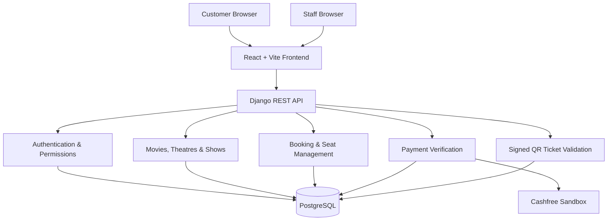

# ClaimMyPass

**A full-stack cinema ticket booking platform developed from an AI-generated prototype into a database-backed web application.**

ClaimMyPass is a cinema ticketing platform that allows customers to explore movies, discover theatres and showtimes, select seats, reserve them temporarily, complete sandbox payments, and access digital tickets. It also includes a staff-only QR scanning interface for ticket verification and admission check-in.

## Project Development Journey

ClaimMyPass started as a React prototype generated with Google AI Studio. The application was subsequently extended into a full-stack system with a Django REST API, PostgreSQL database, authentication, booking workflows, payment integration, and ticket verification.

The repository preserves both stages:

| Branch | Description |
|---|---|
| `ai-studio-baseline` | Original Google AI Studio-generated project |
| `main` | Extended full-stack ClaimMyPass application |

The baseline branch preserves the original committed starting point, allowing the development progression to be reviewed.

## Features

### Customer experience
- Movie discovery and featured movie showcase
- Movie details and filtering
- City, theatre and showtime selection
- Dynamic seat selection and auditorium layouts
- Temporary seat reservations with expiration
- Concession selection
- Customer registration and authentication
- Booking history and persistent digital passes
- Downloadable PDF tickets and ticket printing

### Booking and payment
- Django-backed booking workflows
- Cashfree sandbox checkout integration
- Server-side payment verification
- Booking persistence through PostgreSQL
- Booking confirmation and digital pass generation

**Payment demonstration:** Cashfree is configured for sandbox testing. This project does not currently accept real customer payments.

### Digital ticket security
- Server-generated signed QR ticket tokens
- QR code verification through the Django backend
- Staff-only ticket validation endpoint
- Duplicate check-in prevention
- Check-in records containing timestamp and staff identity

### Staff and administration
- Dedicated staff scanner at `/staff/scanner`
- Camera-based QR scanning
- Backend-enforced staff authorization
- Django administration interface
- Movie activation and featured movie management
- Theatre, screen and show management

## Technology Stack

| Layer | Technology |
|---|---|
| Frontend | React 19, TypeScript |
| Build tool | Vite 8 |
| Styling | Tailwind CSS 4 |
| Animations | Framer Motion |
| Backend | Python 3.14, Django 6.1 |
| API | Django REST Framework |
| Database | PostgreSQL |
| Authentication | Django Token Authentication |
| Payment integration | Cashfree Sandbox |
| QR generation | `qrcode` |
| QR scanning | `html5-qrcode` |
| PDF generation | jsPDF, html2canvas |
| Package manager | Bun |

## System Architecture



## Booking Workflow

1. Customer signs in.
2. Customer selects a movie, theatre and showtime.
3. Available seats are retrieved from the backend.
4. Selected seats are temporarily held.
5. Customer selects concessions and proceeds to checkout.
6. Cashfree sandbox checkout is initialized.
7. Django verifies the payment status.
8. A confirmed booking and digital ticket become available.
9. The customer can view, download or print the ticket.

## Staff Check-in Workflow

1. Staff opens `/staff/scanner`.
2. The application verifies staff authorization with Django.
3. Staff starts the camera scanner.
4. The QR code is scanned and sent to the backend.
5. Django verifies the server-signed token and booking status.
6. A successful first scan records the check-in timestamp and staff account.
7. Subsequent scans of the same ticket are rejected.

## Project Structure

```text
ClaimMyPass/
│
├── backend/
│   ├── accounts/
│   ├── config/
│   ├── movies/
│   ├── payments/
│   ├── manage.py
│   ├── requirements.txt
│   └── .env.example
│
├── public/
│
├── src/
│   ├── components/
│   │   ├── auth/
│   │   ├── checkout/
│   │   ├── common/
│   │   ├── layout/
│   │   ├── movies/
│   │   ├── seats/
│   │   ├── staff/
│   │   ├── theatres/
│   │   └── tickets/
│   │
│   ├── context/
│   ├── data/
│   ├── services/
│   ├── types/
│   ├── App.tsx
│   └── index.css
│
├── .env.example
├── .gitignore
├── package.json
├── bun.lock
├── tsconfig.json
└── vite.config.ts
```

## Local Development Setup

### Prerequisites

- Python 3.14
- PostgreSQL
- Bun
- Git

### 1. Clone the repository

```bash
git clone https://github.com/abinanilkumar-7/ClaimMyPass.git
cd ClaimMyPass
```

The default branch contains the full-stack implementation.

### 2. Set up the frontend

```bash
bun install
```

Create the root `.env` file:

```env
VITE_API_BASE_URL=http://127.0.0.1:8000
```

### 3. Set up the Django backend

Open a separate terminal:

```bash
cd backend

python -m venv .venv
```

Activate the virtual environment on Windows:

```powershell
.\.venv\Scripts\Activate.ps1
```

Install dependencies:

```bash
pip install -r requirements.txt
```

Create `backend/.env` using `backend/.env.example` as a reference.

Configure your local PostgreSQL database and Django settings. For local development, set:

```env
DJANGO_DEBUG=True
DJANGO_ALLOWED_HOSTS=localhost,127.0.0.1
DB_NAME=claimmypass
DB_USER=postgres
DB_PASSWORD=your_local_database_password
DB_HOST=127.0.0.1
DB_PORT=5432
FRONTEND_URL=http://localhost:3000
```

Keep `CASHFREE_ENV=sandbox` for payment demonstrations.

### 4. Apply database migrations

```bash
python manage.py migrate
```

Create a Django administrator account:

```bash
python manage.py createsuperuser
```

Start the backend:

```bash
python manage.py runserver 127.0.0.1:8000
```

Django API: `http://127.0.0.1:8000`

Django Admin: `http://127.0.0.1:8000/admin/`

### 5. Start the frontend

In the frontend terminal, from the project root:

```bash
bun run dev
```

Frontend: `http://localhost:3000`

The frontend communicates with Django using `VITE_API_BASE_URL`.

## Useful Commands

### Frontend

```bash
bun install
bun run dev
bunx tsc --noEmit
bun run build
bun run preview
```

### Backend

```bash
python manage.py check
python manage.py migrate
python manage.py showmigrations
python manage.py collectstatic --noinput
python manage.py test
```

## Environment Variables

Actual `.env` files are intentionally excluded from version control.

| Variable | Purpose |
|---|---|
| `VITE_API_BASE_URL` | Django API base URL used by the frontend |
| `DJANGO_SECRET_KEY` | Django secret key |
| `DJANGO_DEBUG` | Development or production debug setting |
| `DJANGO_ALLOWED_HOSTS` | Permitted Django hostnames |
| `DATABASE_URL` | Hosted PostgreSQL connection URL |
| `DB_NAME`, `DB_USER`, `DB_PASSWORD` | Local PostgreSQL configuration |
| `DB_HOST`, `DB_PORT` | Local database connection details |
| `CORS_ALLOWED_ORIGINS` | Allowed frontend origins |
| `CSRF_TRUSTED_ORIGINS` | Trusted HTTPS and frontend origins |
| `CASHFREE_ENV` | Cashfree environment; keep `sandbox` for this demonstration |
| `CASHFREE_APP_ID` | Cashfree sandbox application ID |
| `CASHFREE_SECRET_KEY` | Cashfree sandbox secret |

Refer to `.env.example` and `backend/.env.example` for configuration templates.

Never commit real credentials, database passwords, API secrets or private keys.

## Deployment

The planned deployment architecture is:

- React frontend: Vercel
- Django REST backend: Vercel Python runtime
- Database: Managed PostgreSQL
- Payments: Cashfree sandbox

Production environment variables, database provisioning, data migration, CORS configuration and live deployment verification must be completed before the application is considered publicly deployed.

## Security Notes

- Backend authentication is required for protected customer operations.
- Staff access is enforced by Django permissions.
- QR tickets use server-side signatures.
- Ticket check-in is protected against duplicate use.
- Payment confirmation is verified by the backend.
- Sandbox payment integration is intended for demonstration and testing.

## Development Status

The application has passed local frontend TypeScript and production-build checks, Django system checks, and static-file collection.

The customer booking, signed QR ticket, PDF download, staff authorization and duplicate check-in workflows have also been exercised locally.

Production deployment and hosted database verification remain separate deployment tasks.

## License

No open-source license has been assigned yet.
